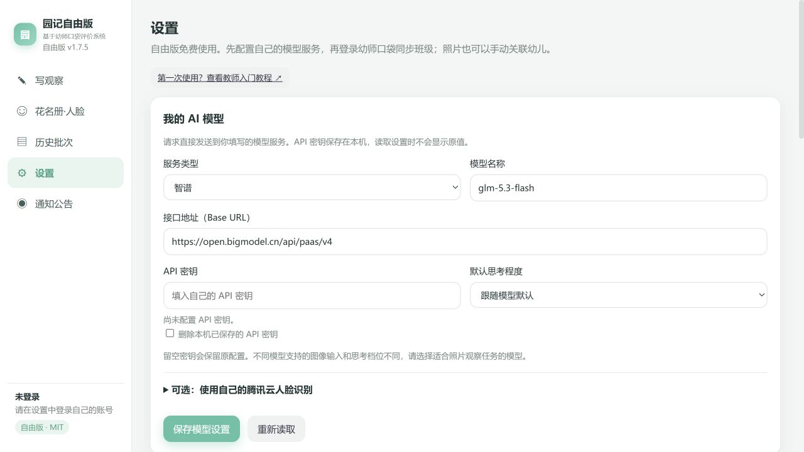

# 园记自由版｜基于幼师口袋评价系统开发的开源助手

园记自由版（Yuanji Free）——把时间还给老师。

本篇是独立第三方工具「园记自由版」的教师入门教程：从下载到第一条记录。

这份教程给没有编程经验的老师。可以先完成“下载—设置 AI—登录—手动选幼儿—生成一条记录”，用顺手了再开启自动认脸。

## 1. 先分清三个账号

| 名称 | 用来做什么 | 要不要配置 |
| --- | --- | --- |
| 幼师口袋账号 | 取得你有权查看的班级、名单、相册，发布审核后的记录 | 使用这些功能时需要 |
| AI 模型服务账号和 API 密钥 | 根据照片和说明生成文字 | AI 写作需要 |
| 腾讯云账号和一对密钥 | 从已录入的人脸底照中匹配幼儿 | 可选；不开也能手动选人 |

**API** 可以理解为“软件向某个服务发请求的通道”。**密钥** 是服务给你的通行凭据，不是这个软件的激活码，也不是幼师口袋密码。三处的账号、余额和密钥互不通用。

园记自由版不用向作者付激活费。你配置的 AI 服务和腾讯云服务可能按使用量计费，费用在各自的平台查看。开源免费不表示第三方云服务免费。

## 2. 下载并解压

1. 在浏览器打开 [项目首页](https://github.com/NB-ZZY/yuanji-free)。
2. 找到绿色 **Code** 按钮，点击 **Download ZIP**。
3. 在“下载”文件夹找到 ZIP。Windows 右键选择“全部解压缩”；macOS 双击解压。
4. 把解压后的文件夹放在容易找到的位置，例如“文档”中的“园记自由版”。不要在 ZIP 压缩包内部直接运行。
5. 打开文件夹，应能看到 `start.cmd`、`launch.py`、`README.md` 和 `app` 文件夹。这是源码包，需要下一步的 Python 才能启动，并非双击就安装的 EXE 安装包。

如果你使用 WorkBuddy、Codex 等本地编程助手，可发送下面这一句：

> 请从 https://github.com/NB-ZZY/yuanji-free 下载项目，阅读 README.md 和 AGENTS.md，安装并启动园记自由版。保持生产数据不动，先把设置页打开给我；我的 API 密钥由我自己在设置页填写，不要替我发记录。

## 3. 第一次启动

### Windows

1. 在 [Python 官方下载页](https://www.python.org/downloads/)下载 **Python 3.12** 对应的 Windows 安装程序，按电脑的处理器类型选择。不要下载源码压缩包。
2. 打开安装程序，勾选 **Add python.exe to PATH**，再安装。它让系统能够找到 Python。
3. 回到刚才解压的项目文件夹，双击 **start.cmd**。如果电脑隐藏扩展名，你可能只看到“start”。
4. 第一次会打开一个文字窗口，下载运行所需的依赖。保持网络连接并等它完成；这不是录入照片或购买服务。不要提前关闭窗口。
5. 随后会出现“园记自由版”。先打开“设置”。

若提示缺少 WebView2，可安装 [微软官方 WebView2 Evergreen Runtime](https://developer.microsoft.com/microsoft-edge/webview2/)。如果只在普通浏览器中打开了界面，扫码登录弹窗功能可能不可用，优先修好桌面运行环境。

### macOS

1. 安装 [Python 官方](https://www.python.org/downloads/)的 Python 3.12 macOS 版本。
2. 打开“终端”，输入 `cd `（末尾有一个空格），把解压的项目文件夹拖进终端，再按回车。
3. 输入 `python3 launch.py`，按回车。等待第一次安装依赖，随后打开程序。
4. 若电脑同时装有多个 Python，请让帮助你配置的人确认当前使用的是兼容版本。

源码版的 Mac 支持取决于 Python、桌面组件和系统版本。本仓库的首次公开检查在 Windows 完成，不能视为旧版 macOS 的实机验收。

## 4. 填写自己的 AI 模型

先登录你选择的模型服务商的官方平台，找到 API 控制台。按服务商要求开通服务、查看费用，创建自己的 API Key。网页聊天会员与 API 额度可能分开；以服务商的说明为准。

选择能够接收**图片与文字**的模型。本软件用图片理解来写观察，只有文字能力的模型即使能聊天，也不一定能完成照片任务。

在软件“设置 → 我的 AI 模型”填写：

| 软件字段 | 从哪里取得 / 如何填写 |
| --- | --- |
| 服务类型 | 选智谱、DeepSeek，或服务商声明支持的 OpenAI 兼容接口 |
| 模型名称 | 复制 API 文档里的模型标识；不是自行取的中文昵称 |
| 接口地址（Base URL） | 复制服务商给出的基础地址；不要填它的网页聊天地址 |
| API 密钥 | 粘贴刚创建的 API Key，不要前后带引号或空格 |
| 默认思考程度 | 初次先选“跟随模型默认”；具体支持程度由模型决定 |

程序会在基础地址后添加 `/chat/completions`，所以不要重复填写这一段。地址里不应包含密钥。例如文档给的是 `https://服务商域名/v1/chat/completions`，这里应填 `https://服务商域名/v1`。

点击 **保存模型设置**。看到“设置已保存”后，密钥框变空是正常的：程序不会把已保存密钥重新显示出来。下次只修改模型名称时，把密钥框留空即可保留原密钥；需要删除才勾选“删除本机已保存的 API 密钥”。

“保存成功”只说明配置写入本机，还没有证明服务端接受了密钥。完成登录后，用一条小记录测试生成，才会实际调用模型。

## 5. 登录自己的幼师口袋

1. 在“设置 → 幼师口袋账号”点击 **登录幼师口袋**。
2. 在出现的提示中点 **打开登录窗口**，按网站页面要求扫码或登录。
3. 登录成功后回到软件，选择自己的班级。
4. 进入 **花名册·人脸**，点击 **从幼师口袋同步名单**，检查班级和名单是否正确。

软件使用你的登录状态访问你本来有权查看的内容，不提供额外班级权限。切换老师时先在设置里退出账号，再登录另一位老师的账号；不要把上一位老师的照片误选到下一位的班级。

## 6. 先手动完成一条记录

1. 打开 **写观察**，选择记录类型及日期。
2. 拖入一张有权使用的照片，或点击照片选择框。从班级相册选图也可以，先核对当前班级。
3. 不开人脸识别时，点击 **整理照片并选择幼儿**，在记录卡片上手动选中对应孩子。合影可以关联多个孩子。
4. 在老师说明中补充你知道的事情，例如“午点后主动收碗，先把勺子放进小桶，再把碗叠好”。真实原话、是否有人帮助、发生顺序都可以写。
5. 确认指标及档位，点击生成。批量时先用一条验证，再扩大数量。
6. 阅读生成的实录、分析和跟进，修改不符合实际的地方。只想重写某一段时用该段旁的重写按钮。
7. 核对孩子、日期、文字与指标后，再使用审核/发布按钮；也可在历史批次中导出 Word。

观察表现有写法允许补全事件前后情节，补写提示不会自动写进正文。它是供教师修改的草稿，不等于照片证明这些情节发生过。**如果不希望补写，在老师说明里明确写“只按实况记录，不补写”。** 随手记不采用观察表的补写许可。

表现行为二、四保留所属能力项，不强制选择该档不存在的具体表现原句。托班使用网站托育体系 **24—36 个月** 档，不套用小中大班标准。

## 7. 想自动识别幼儿，再开启腾讯云

按 [腾讯云人脸识别手把手教程](tencent-face-guide.md)完成开通、权限、密钥、底照录入和识别验证。不要直接拿 AI 密钥填到腾讯云 SecretKey。

自动识别提供候选结果，发布前仍需人工确认。没有底照、脸被遮挡或认错时，直接手动选择即可。

## 8. 常见问题

| 现象 | 先检查 |
| --- | --- |
| 双击 start 没启动，提示找不到 Python | Python 是否安装完成并加入 PATH；关掉旧文字窗口后重开 |
| 第一次一直显示下载依赖 | 查看文字窗口的报错，确认网络可访问 Python 包源；保留报错给技术助手，不贴密钥 |
| 401、密钥无效 | 当前服务类型、地址和密钥是否来自同一家；是否已经删除/停用密钥 |
| 模型不存在、404 | 模型名称是否为 API 标识；Base URL 是否多写了 `/chat/completions` |
| 不支持图片或 image_url | 更换服务商明确支持图片输入的模型 |
| 429、额度不足、限流 | 查看模型平台余额与配额，减少同时生成数量；不要连续重复点击 |
| 保存后密钥输入框为空 | 正常隐藏；看“已有 API 密钥”状态，留空保存会保留 |
| 配置字段灰色，提示环境变量 | 启动者在 `.env` 或系统环境中固定了该字段；修改对应配置并重启 |
| 扫码窗口没出现 | 使用桌面模式；点“登录老是不成功？点这里自查”，记录系统版本和错误信息 |
| 相册照片加载失败 | 核对网站登录状态与网络；先在官网确认该照片可见，保存工作后再重登 |
| 找不到月度评价 | 园记自由版不包含该功能及配套课程包 |

提问时只发必要的报错与操作步骤。请遮住孩子姓名、脸、家长信息和密钥；不要上传整个数据文件夹到公开 Issue。

## 9. 保存、备份和更新

数据与程序文件分开放置。Windows 默认在 `%APPDATA%\kidobs-community`；可在资源管理器地址栏输入这一行进入。Mac 默认在 `~/Library/Application Support/kidobs-community`。如由技术助手配置了其他路径，看设置底部的“本机数据目录”。

备份时先正常退出程序，再复制完整数据目录到自己保管的位置。里面含照片、草稿、登录状态和密钥，不能当作普通教程附件公开发送。

更新源码时先备份数据、关闭程序，再下载新版源码到新文件夹并启动；使用 Git 的人可以 `git pull`。个人资料不在源码目录内，通常无需重复导入；不要为了更新去删除数据目录。园记自由版不连接商业版自动更新服务。

## 10. 写作流程在哪里

- [共用写作流程](../app/data/writing/SKILL.md)：证据边界、中文表达、经验与支持。
- [观察记录专用流程](../app/data/observation/SKILL.md)：连续白描、补写、循证分析与跟进。
- [托班流程](../app/data/observation/NURSERY_SKILL.md)：24—36 个月的适龄表达和指标边界。

可以用文本编辑器阅读和修改这些 Markdown 文件。它们是程序给 AI 的写作说明，不是模型训练文件；改完重启程序，新生成内容才使用新说明，旧草稿不会自动重写。
