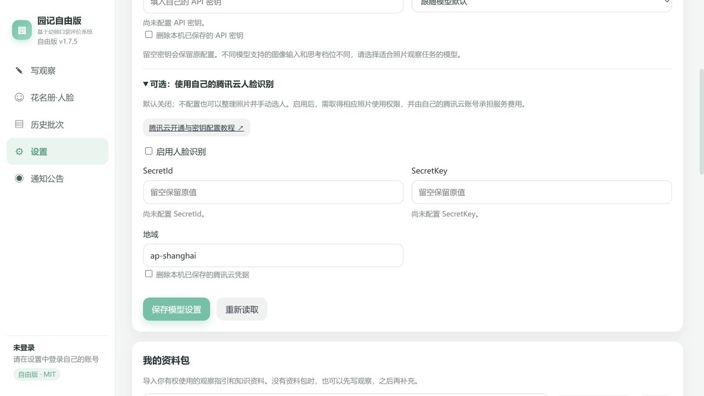

# 腾讯云人脸识别：教师开通与配置教程

适用：园记自由版｜基于幼师口袋评价系统开发的开源助手（Yuanji Free，独立开发的第三方工具）。核对日期：2026 年 10 月 22 日。软件按钮按本仓库当前版本说明，腾讯云页面以后可能调整。

**人脸识别是选配功能。** 不开通、不填腾讯云密钥，也可以在「写观察」中整理照片、手动选择幼儿，再让 AI 写作。只想先试软件的老师，可以先看[教师入门教程](teacher-guide.md)，暂时跳过本文。

开通后，软件会把用于识别或入库的照片发往你的腾讯云账号。录底照时还会提交幼儿姓名、人员编号和班级库信息。请在园所允许的范围内使用，并取得所需的照片及人脸信息使用授权；没有相应授权就使用手动选人。

## 1. 先分清两种密钥

| 软件里的项目 | 用来做什么 | 从哪里取得 |
| --- | --- | --- |
| AI 模型的 API 密钥 | 看图、生成观察文字和分析 | 你选用的模型服务商 |
| 腾讯云 SecretId 与 SecretKey | 给照片找出可能是哪位幼儿 | 你自己或园所的腾讯云账号 |

两种密钥不能混填。腾讯云这一对密钥也不是微信小程序 AppID、AppSecret，更不是服务器的登录密码。

这里调用的是腾讯云提供的**人脸识别 API（IAI）**。API 可以理解为软件向云端发送一次处理请求的入口；为了这个功能，**不需要另外买云服务器、域名或部署网站**。园记自由版的依赖安装已包含所需组件，不用另找 SDK 安装。

## 2. 注册、实名，并开通正确的服务

1. 打开[腾讯云](https://cloud.tencent.com/)，用你或园所管理的账号登录；没有账号则先注册。
2. 按账号页面要求完成实名认证。园所统一使用时，先确定由谁负责云账号、费用和数据管理。
3. 打开[人脸识别控制台](https://console.cloud.tencent.com/aiface)。确认产品是**人脸识别**，不是“人脸核身”、身份证核验或微信支付认证。
4. 阅读页面的服务规则和计费提示，由账号负责人决定是否开通；按页面提示完成。

腾讯云官方流程要求实名后再开通服务；完整页面说明见[人脸识别快速入门](https://cloud.tencent.com/document/product/867/54248)。本教程不替你购买套餐，也不承诺开通或后续调用一定免费。

## 3. 给软件建一个专用子用户

主账号留给管理员。软件使用一个只承担人脸识别工作的子用户，便于以后停用或更换密钥。

1. 在腾讯云控制台搜索并进入「访问管理（CAM）」。
2. 进入「用户 → 用户列表」，选择「新建用户 → 自定义创建」。
3. 用户类型选「可访问资源并接收消息」。取一个便于辨认的名字，例如 `kidobs-teacher`。
4. 若页面询问访问方式，软件只需要 API／编程访问；不用为此开放控制台登录。完成创建。
5. 暂时不要给这个用户添加全云管理员权限。下一步会专门给它人脸识别所需权限。

不要为了省步骤使用带管理员权限的快速创建方式。入口可对照腾讯云[新建子用户说明](https://cloud.tencent.com/document/product/598/13674)。

## 4. 授予当前软件需要的权限

这一段只需做一次。下面的内容是**权限配置，不是密码**，可以完整复制。它列出了当前软件实际调用的 10 个操作，没有开放云服务器、支付或其他产品管理。

1. 在 CAM 的「策略」页面选择「新建自定义策略 → 按策略语法创建」。
2. 选择「空白模板」，进入编辑页面。
3. 策略名称填 `KidobsFaceApiAccess`，清空编辑框里的原内容，粘贴下面整段 JSON，然后完成创建。

入口依据腾讯云[通过策略语法创建自定义策略](https://cloud.tencent.com/document/product/598/80789)；空白模板和关联用户操作可对照[官方策略操作示例](https://cloud.tencent.com/document/product/598/55150)。无需选择该文档示例中的其他产品权限。

```json
{
  "version": "2.0",
  "statement": [
    {
      "effect": "allow",
      "action": [
        "name/iai:GetGroupList",
        "name/iai:CreateGroup",
        "name/iai:GetPersonList",
        "name/iai:GetPersonBaseInfo",
        "name/iai:CreatePerson",
        "name/iai:CreateFace",
        "name/iai:DeleteFace",
        "name/iai:DeletePerson",
        "name/iai:SearchFaces",
        "name/iai:DetectFace"
      ],
      "resource": ["*"]
    }
  ]
}
```

4. 回到策略列表，找到 `KidobsFaceApiAccess`，点「关联用户/组/角色」，勾选刚创建的专用子用户并确认。
5. 检查该子用户确实已关联这条策略，没有额外关联 `AdministratorAccess`。

这里的 `resource: ["*"]` 是因为部分操作只能按接口授权；它允许这些操作访问该云账号下适用的人脸资源，**不是按某一位老师隔离权限**。腾讯云确有范围更宽的预设策略 `QcloudFRFullAccess`，但本教程优先使用上述操作清单；只读策略无法录入或删除底照。依据：[人脸识别子账号访问管理](https://cloud.tencent.com/document/product/867/35076)。

## 5. 创建并保存 SecretId 和 SecretKey

1. 回到 CAM「用户列表」，点击刚才的子用户名称。
2. 打开「API 密钥」页签，选择「新建密钥」。
3. 将 **SecretId 和 SecretKey 两项一起**保存到自己的密码管理器等安全位置，确认保存成功后再关页面。

SecretKey 只在创建时显示，之后不能重新查出原值；丢失时需要创建新的一对并替换。官方步骤见[子账号访问密钥管理](https://cloud.tencent.cn/document/product/598/37140)。

不要把密钥发到教师群、GitHub 问题区或截图里，也不要填进共享资料包。排查问题只提供错误代码和已打码的页面；软件作者不需要收到你的密钥。

## 6. 填入软件，先测试连接

打开园记自由版「设置」，找到「我的 AI 模型」，展开**「可选：使用自己的腾讯云人脸识别」**。



| 设置项 | 怎么填 |
| --- | --- |
| 启用人脸识别 | 勾选 |
| SecretId | 粘贴刚创建的 SecretId，前后不要带空格或引号 |
| SecretKey | 粘贴与它配对的 SecretKey |
| 地域 | 初次使用保留软件默认的 `ap-shanghai`；已有配置先保持一致 |

1. 点击**「保存模型设置」**。这个按钮会同时保存腾讯云设置。
2. 看到保存成功后，向下找到「人脸识别服务（腾讯云）」，点击**「测试连接」**。
3. 正常会显示“连接正常，云端已有 … 个班级人脸库”。第一次显示 **0 个也正常**，还没有录底照。

测试连接只查询云端人员库列表；它证明这次查询可用，不代表所有录入和识别操作都已验证。下一节会做一次小范围实测。

保存后输入框变空是正常的，旁边的“已配置”状态才表示是否已保存。再次保存时，**密钥留空会保留原值**。要清除它们，勾选「删除本机已保存的腾讯云凭据」再保存；这也会关闭识别。

如果看到某个字段被“环境变量”覆盖，页面无法修改它。请让安装软件的人检查启动配置，避免反复在界面填相同内容。

本机设置文件位于设置页底部显示的“本机数据目录”中的 `settings.json`。当前版本是本地明文保存，不是密码保险箱；不要把整个数据目录发给别人或上传到公共仓库。

## 7. 同步班级，为一位幼儿录底照

先用一位幼儿的小样本走通流程，再扩展到全班。

1. 在「设置 → 幼师口袋账号」点击**「登录幼师口袋」**，按网站提示用你有权限的账号登录。
2. 在「班级」核对当前班级，必要时点击**「切换班级」**。
3. 打开左侧**「花名册·人脸」**，点击**「从幼师口袋同步名单」**。确认看到的是当前班幼儿。
4. 如果园所已在同一个腾讯云账号下建过这个班的人脸库，先点**「查云端已有」**，避免无意重复录入。
5. 点击一位幼儿的卡片，在弹窗的**「拖入照片，或点击选择」**区域上传底照。先用一张清楚、无遮挡、能看清正脸的单人照片；以后可补到 2—3 张不同时间的清楚照片。
6. 核对卡片姓名与照片是同一人。**照片出现在卡片上只表示已存到本机，不等于已上传腾讯云。**
7. 回到花名册，点击**「把新照片入库」**；有待处理照片时按钮会显示数量。等待处理结束，查看入库结果；有失败提示就先处理失败项。

当前程序每位幼儿最多维护 5 张云端底照，超过时会尝试替换较早的底照。录入时程序信任老师选定的人名，不会替你保证新照片与旧底照属于同一个人，因此**姓名与照片必须人工核对**。

「从历史记录自动找底照」「整包照片自动归档」适合基本流程成功后再用。它们可能处理很多图片、产生多次云端调用，不适合作为首次连接测试。

## 8. 用另一张照片试识别，并人工确认

1. 回到**「写观察」**，上传一张刚才那位幼儿的另一张清楚照片，也可用「从班级相册选照片」。
2. 点击**「开始识别」**，等待出现候选幼儿或记录内容。
3. 逐项核对：照片里是谁、是否漏了同伴、有没有认成另一个孩子。疑似候选可以点击选用，不合适则手动选择正确幼儿。
4. 确认人物后再生成观察文字，检查实录、分析和指标，最后自行决定是否发布。

识别分数是候选匹配依据，不是身份保证。相似面孔、遮挡、背面或很小的人脸都可能匹配不准；不要只因分数高就跳过审核。

如果不想继续用识别，在设置里取消「启用人脸识别」并保存。首页按钮会变为**「整理照片并选择幼儿」**，手动流程仍可使用。AI 的“默认思考程度”与人脸识别无关，是否支持各思考档位取决于你配置的模型。

## 9. 费用从哪里看

腾讯云人脸识别有按调用次数等计费方式，部分服务有免费额度；**免费包耗尽后可能转为付费调用**。请以自己账号当时的资源包、计费方式和账单为准，不能把“软件免费”理解成人脸云服务无限免费。依据：[腾讯云计费概述](https://cloud.tencent.com/document/product/867/17640)。

第一次试用后，回到人脸识别控制台查看调用情况和资源包消耗，再到腾讯云费用页面查看账单，按账号支持的方式设置费用提醒。使用全班历史照片前先估算图片量：本软件可能先检测人脸、再搜索，补录底照还会调用创建人员或增加人脸，**一张图片不一定只对应一次请求**。

不确定是否还会计费时，先在软件停用识别并停止相关任务，再找云账号负责人核对；不必为了试通软件立即购买大额套餐。

## 10. 换老师、停用与清理数据

### 多位老师使用时，先分清本机与云端

- **幼师口袋账号**：在软件里退出、换账号，是切换当前老师的名单和业务数据。
- **腾讯云密钥**：是这份软件的本机配置，不会随幼师口袋老师退出而自动更换。接手电脑前检查它属于谁、费用由谁承担。
- **腾讯云人脸库**：当前按班级编号建库，库 ID 为 `kidobs_班级编号`；人员 ID 为 `s幼儿编号`。同一腾讯主账号下，同一个班级会复用同一云库。

给不同老师建不同的腾讯云子用户便于撤销各自密钥，但**子用户仍访问所属主账号的资源**。本文权限没有提供严格的按老师隔离；同班老师的删除或替换底照可能影响彼此。这个资源关系也见[腾讯云子账号密钥说明](https://cloud.tencent.cn/document/product/598/37140)。

园所统一管理时，应由管理员决定谁能录入和删除。同一台电脑需要分开保管密钥时，可使用不同操作系统用户及独立的软件数据目录。若要求不同单位的云资源完全分开，使用各自管理的腾讯云主账号，不要把“换一对子用户密钥”当成资源隔离。

### 只想暂时不用

在设置取消「启用人脸识别」，点击「保存模型设置」，等待正在进行的相关任务结束。这样以后可手动选人，但**云端已录入的数据仍在**。

### 不再允许这台电脑使用该密钥

先停用识别；由云账号负责人在 CAM 对应子用户的「API 密钥」页禁用该密钥，确认其他使用方不再需要后再删除。软件里勾选「删除本机已保存的腾讯云凭据」并保存，只清理本机配置，不会替你撤销云端密钥。官方步骤见[密钥禁用与删除](https://cloud.tencent.cn/document/product/598/37140)。

### 需要清理已经录入的云端人脸

1. 先和使用同一云库的老师确认清理范围，暂停该班的自动入库任务。
2. 软件底照缩略图的 **✕** 会删除本机记录，并在有入库记录时尝试删除对应云端人脸；但当前代码在云端删除失败后仍可能完成本机删除，**不能把本机照片消失当作云端已清空**。删除某人的最后一张本地已入库照片时，程序还可能删除云端整个人员，影响共享使用者。
3. 用腾讯云主账号或负责管理数据的账号打开人脸识别控制台，核对人员库名称、`kidobs_…` 库 ID 及人员。只清理已经确认不再需要的对象，并重新查询结果。
4. 要删除整个班级库而控制台没有相应入口时，让管理员打开[删除人员库官方文档](https://cloud.tencent.com/document/api/867/45012)，通过其中的“点击调试”进入 API Explorer，核对地域与准确的 GroupId 后再操作。本文的软件子用户策略没有授予 `DeleteGroup`，不要为了清库给所有老师加管理员权限。
5. 删除人员库会同时清理其中相应人员与人脸；仍关联其他库的人员可能保留。需要彻底清理某个人时，应让管理员同时检查其余库的关联，不能只凭一个库消失判断。规则见[删除人员库说明](https://cloud.tencent.com/document/api/867/45012)。

退出登录、卸载软件、清除密钥都不会自动清空腾讯云人脸库。本机照片、导出文件和备份也需要分别处理。程序会发送图像供云端处理，本教程不把它描述为“只上传特征、绝不保留图片”；关于服务侧的完整留存范围，请由账号负责人按服务条款或通过腾讯云工单确认。

## 11. 常见问题

| 看到的情况 | 先做什么 |
| --- | --- |
| 「测试连接」不能点击 | 勾选启用识别，填写配对密钥并保存；未启用时按钮会禁用。 |
| 提示未配置密钥、`NOKEY` | 检查 SecretId 和 SecretKey 是否都已保存，不要把 AI 密钥填在这里。 |
| `AuthFailure.SignatureFailure`、`AuthFailure.SecretIdNotFound` | 从自己的安全记录重新复制配对密钥，核对是否已被禁用或删除；同时检查电脑时间。无法找回 SecretKey 时创建新密钥。 |
| `UnauthorizedOperation` | 检查策略是否确实绑定到这对密钥所属的子用户，以及 JSON 是否完整。提示即使提到 `QcloudFRFullAccess`，也先核对本文的精确操作策略，不必直接加全云管理员权限。 |
| `FailedOperation.ServiceNotActivated` | 回到这个子用户所属主账号，确认开通的是人脸识别服务。 |
| `ResourceUnavailable.InArrears` 或 `Freeze` | 让账号负责人核对欠费或账号冻结状态。 |
| 连接正常，但识别不到任何人 | 查询成功不等于已录底照。核对当前班级，点「查云端已有」，确认底照已入库，再试单人清楚照片。 |
| 没有人脸、`NoFaceInPhoto`、`FaceSizeTooSmall` | 换清楚的正脸近照；作品照或背影直接手动选人。 |
| 人脸库不存在、人员不存在 | 核对腾讯账号、地域、当前班级是否与入库时一致，询问是否有人清理过云库；不要直接把全班重复导入。 |
| `ImageSizeExceed`、图片无法解码 | 换正常可打开的 JPG／PNG，必要时缩小图片后重试。 |
| 超时、无法连接腾讯云 | 检查本机网络，稍后小批量重试；先不要重复点全班扫描。 |
| 一直认错同一个孩子 | 先人工改选，检查底照是否配错姓名；共享云库要一起检查其他老师录入的底照。 |
| 提示缺少 `tencentcloud` 组件 | 使用仓库提供的启动方式重新完成依赖安装；不要下载来历不明的 SDK。仍失败时提供报错文字给维护者。 |

提问时可以提供：软件版本、操作按钮、错误代码、是否刚换过班级或密钥。**不要公开密钥、未打码的幼儿照片、真实花名册或整份本机数据目录。**
